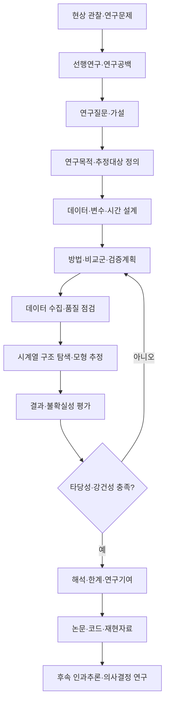

# End-to-End Time Series Research Process

> **AI 기반 시계열 연구방법론 — 박사과정 연구 프로세스**  
> **From Temporal Patterns to Research Evidence**  
> [저장소 홈](../README.md) · [강의계획](../COURSE_SYLLABUS.md) · [48개 자유선택형 실습](../TimeSeriesResearchMethods_Labs.md) · [연구설계](../research_design/) · [검증](../validation/)

## 1. 목적과 적용 범위

이 문서는 **시간의 패턴을 분석하는 것에서 시작하여 재현 가능한 학술적 증거를 만들기까지**의 전체 연구과정을 설명합니다. 시계열을 이용한 **구조 분석·예측·탐지·인과추론·패널분석**은 연구목적과 검증 기준이 다릅니다. **의사결정 최적화·고급 인과식별은 후속 심화과정**이며, 본 과정에서는 연결 개념을 학습합니다.

단순한 `데이터 → 모형 → 결과`가 아니라 **현상 → 선행연구 → 연구질문 → 설계 → 분석 → 검증 → 학술적 기여**를 하나의 논리로 연결합니다. 어느 단계에서든 가정이 무너지거나 새 증거가 발견되면 이전 단계로 되돌아갑니다.

## 2. 다섯 개 연구 단계(Research Phases)

| Phase | 질문 | 핵심 활동 | 검토 산출물 |
|---|---|---|---|
| **1. Research Foundation** | *무엇이 아직 밝혀지지 않았는가?* | 현상 관찰, Anchor Research 검토, Research Gap, RQ·가설 | 연구문제·선행연구 매트릭스·RQ |
| **2. Research Design** | *무엇을 어떤 근거로 추정할 것인가?* | 목적·대상·분석단위·시간·변수, 설계·식별가정·평가계획 | 연구설계서·데이터 사전·검증 계획 |
| **3. Data & Modeling** | *자료가 가정과 분석을 뒷받침하는가?* | 수집·전처리, 시간 구조 분석, 기준모형·주모형 추정 | 데이터 품질표·모형·코드 |
| **4. Evidence & Validation** | *다른 설정에서도 주장이 유지되는가?* | 표본외 검증/식별 진단, 불확실성, 강건성, 누수·재현성 점검 | 결과표·검증 보고서 |
| **5. Research Contribution** | *RQ에 무엇을 답했고 무엇을 답하지 못하는가?* | 주장-증거 정합성, 선행연구 대화, 한계, 논문 작성 | Results·Discussion·재현 가능한 연구 산출물 |

## 3. 세부 12단계 체크리스트

| 단계 | 핵심 질문 | 실행 작업 | 통과 확인사항 / 산출물 |
|---|---|---|---|
| **01 현상·문제 정의** | 어떤 변수·개체가 시간에 따라 변하는가? | 현상과 정책·산업적 맥락 명세 | 문제정의 3~5문장 |
| **02 선행연구 검토** | 핵심 연구자는 어떤 모형·데이터를 사용했는가? | 대표 논문 심층 독해, 공통·상충 결과 비교 | 연구 흐름·핵심 논문 표 |
| **03 Research Gap** | 기존 지식의 무엇이 부족한가? | 자료·조건·방법·메커니즘의 공백 구분 | 검증 가능한 공백 진술 |
| **04 RQ·가설 정의** | 어떤 주장에 답할 것인가? | 목표변수, 시간범위, 가설 및 반증 조건 명시 | RQ 및 H1... |
| **05 연구목적·설계** | 예측인가, 인과인가, 탐지인가? | 예측 원점·horizon 또는 개입·반사실·추정대상 정의 | 설계·평가지표 사전 명세 |
| **06 데이터·변수 설계** | 그 시점에 실제로 알 수 있었나? | 분석단위, 발표시차, 집계규칙, 결측·개정자료 점검 | Data Dictionary·출처·버전 |
| **07 시계열 EDA** | 추세·계절성·상관·구조변화는? | 시각화, ACF/PACF, ADF/KPSS, 구조변화·이상치 조사 | EDA·가정 진단 |
| **08 모형 구현** | 왜 이 모형이 RQ에 맞는가? | 기준선, 주모형, 복잡도·하이퍼파라미터 설정 | 수식·코드·추정 절차 |
| **09 핵심 결과·검증** | 성과 또는 효과는 무엇인가? | 예측 성능 또는 효과크기·표준오차·신뢰구간 분석 | 결과표·그림·불확실성 |
| **10 강건성·재현성** | 표본·가정·변수에 민감한가? | 대안표본·사양·Placebo·재실행, 의존성 고려 | 강건성표·재현 스크립트 |
| **11 결과 해석·논의** | RQ에 어떤 범위까지 답할 수 있나? | 이론과 연결, 다른 설명 검토, 한계 공개 | Discussion 논리·기여 |
| **12 논문화·후속 연구** | 타인은 결과를 반복할 수 있나? | 표·그림·방법·버전·인용·공개 범위 정리 | 원고 초안·코드·자료 설명 |

> **중요:** 05~06 단계에서 설계하는 분석·검증 계획은 실제 결과를 보고 유리하게 바꾸지 않는 것을 원칙으로 합니다. 탐색적 변경은 분리 기록합니다.

## 4. 연구목적별 분기: 같은 데이터, 다른 연구

| 분석 목적 | 연구질문 예시 | 방법론 예시 | 먼저 검증할 것 | 결과로 주장 가능한 것 |
|---|---|---|---|---|
| **구조 이해** | 추세·계절성·변동성 군집이 있는가? | STL, ACF, ADF/KPSS, ARCH | 시계열 구조·검정가정·기간별 안정성 | 관측된 시간 구조 |
| **예측** | 시점 t에 미래 t+h를 예측할 수 있는가? | Naive, ARIMA, XGBoost, LSTM, TSFM | 시간순 외표본, 비교기준선, 데이터 누수, 예측구간 | 표본외 예측 성능 |
| **이상탐지** | 이상을 얼마나 빨리 탐지하는가? | 관리도, Isolation Forest, Autoencoder | 라벨·탐지지연·오경보·시점 정보 | 탐지 성능·운영 비용 |
| **인과추론** | 개입이 결과를 바꿨는가? | ITS, DID, Synthetic Control | 반사실, 식별가정, 동시충격·Placebo | 가정하에서의 인과효과 |
| **패널·이질성** | 개체별 차이 또는 효과 차이는? | FE, RE, TWFE, 상호작용 | 개체·시간 교란, 공분산·군집, 내생성 | 통제 조건하 관련성; 인과는 별도 식별 필요 |
| **의사결정(연결)** | 예측을 이용해 무엇을 선택할까? | 최적화, 비용민감 정책, RL | 손실함수·제약·비용·운용 안정성 | 의사결정 효용 (심화강의 주제) |

**예측 정확도는 인과적 식별을 보장하지 않습니다.** 또한 FE가 있다고 해서 시간에 따라 변하는 교란이나 처치효과 이질성이 자동으로 해결되지 않습니다.

### 예측 → 의사결정의 연결 예시

미래값 예측 자체가 최종 목적이 아닐 수 있습니다. 행동의 비용·제약을 고려해 다음과 같이 확장할 수 있습니다.

\[
a_t^* = rg\min_{a\in\mathcal A} E[L(a,Y_{t+h})\mid\mathcal I_t]
\]

- \(\mathcal I_t\): 시점 \(t\)에 실제로 이용 가능한 정보
- \(\mathcal A\): 허용된 행동의 집합
- \(L\): 오차뿐 아니라 비용·위험까지 반영한 손실함수

이는 **후속 의사결정과학 강의로 가는 연결 개념**으로만 다룹니다.

## 5. Chapter 1~8과 연구 단계의 연결

| Chapter | 연구질문 | 역할 | 연결 Phase | 해당 장의 연구 산출물 |
|---|---|---|---|---|
| **01** | 시간의 변화에는 어떤 규칙이 존재하는가? | 데이터의 시간적 구조와 분석 가정 탐색 | 2~3 | EDA·정상성 진단 |
| **02** | 과거의 데이터로 미래를 예측할 수 있는가? | 통계적 기준선과 모형 타당성 | 2~4 | ARIMA·SARIMA 비교/잔차 |
| **03** | 인공지능은 시간의 패턴을 어떻게 학습하는가? | 비선형성과 일반화 가능성 | 3~4 | ML/DL 외표본 결과 |
| **04** | AI는 경험하지 못한 미래도 예측할 수 있는가? | 사전학습 모델 전이와 오염 위험 | 3~4 | Zero-shot·기준선 비교 |
| **05** | 함께 변화하는 현상은 인과관계가 있는가? | 반사실·기초 식별가정 | 2~4 | ITS·DID·SC 설계·효과 |
| **06** | 같은 변화가 모든 대상에게 동일하게 나타나는가? | 개체·시간 효과, 차이의 구조 | 2~4 | 패널·상호작용 추정 |
| **07** | 분석 결과는 얼마나 신뢰할 수 있는가? | 누수·가정·강건성·재현성 감사 | 4 | Validation Report |
| **08** | 연구질문에 적합한 시계열 분석방법은 무엇인가? | 전체 과정 통합·연구 기여 | 1~5 | 연구설계·Methods/Results 초안 |

**Chapters는 12단계 연구과정과 동일한 시간 순서가 아닙니다.** 예를 들어 선행연구 검토와 RQ 설정은 모든 챕터 실습 전에 수행해야 하며, 데이터 검증과 재현성 확인은 Chapter 7뿐 아니라 매 챕터에서 반복합니다.

## 6. 6개 도메인 자유 선택형 적용

수강생은 매 Chapter에서 **금융·투자 / 부동산 / 제조·품질 / 공공정책 / 에너지·환경 / 경영·마케팅** 중 원하는 분야를 선택합니다. 다음 챕터에서 다른 분야를 선택해도 됩니다.

각 Colab은 독립 실행되도록 설계하며 다음 순서를 공통 적용합니다.

1. **Research Question:** 현상과 분석 목적·반증 가능 조건 정의
2. **Theory & Formula:** 핵심 이론, 가정, 수식
3. **Data & Time:** 출처, 관측단위, 수집·공표 시점, 전처리
4. **Methods & Baselines:** 선택 근거, 비교 기준
5. **Execution:** Colab 코드와 표·그래프
6. **Interpretation:** 결과의 통계적·실무적 의미, 주장 범위
7. **Validation:** 예측 검증 혹은 인과 식별·표준오차·강건성
8. **Research Assignment:** 요약 표·그림, 한계, 논문형 문단

- [전체 실습 가이드](../TimeSeriesResearchMethods_Labs.md)
- [6개 도메인 데이터 수집 입문](../data_sources/)
- [데이터 출처 카탈로그](../resources/Data_Source_Catalog.md)
- [연구보고서 템플릿](../assignments/Research_Report_Template.md)

> **현재 개발 단계:** 모든 48개 실습이 완성된 것은 아닙니다. 실습 가이드의 `✅ 예제` / `📝 템플릿` 상태를 확인하십시오.

## 7. 단계별 품질 게이트(Research Quality Gates)

| 게이트 | 확인 질문 | 실패 시 조치 |
|---|---|---|
| **G1 · RQ & Gap** | 연구질문이 선행연구의 공백과 연결되는가? | 선행연구·가설 재정리 |
| **G2 · Data Integrity** | 시간·단위·공표시점·선택편향을 기록했는가? | 데이터 재구성, 설계 수정 |
| **G3 · Method & Identification** | 선택한 모형과 비교 기준, 인과적 가정이 타당한가? | 목적·모형·식별전략 변경 |
| **G4 · Validation** | 외표본/강건성·불확실성을 적절히 검증했는가? | 평가계획·모형 재검토 |
| **G5 · Claim & Reproducibility** | 논문 주장이 증거의 범위에 맞으며 재현 가능한가? | 주장 축소·한계·코드 기록 보완 |

이 게이트는 수강생의 코드 실행 성공 여부뿐 아니라 **학술적 주장과 근거의 일치 여부**를 확인하는 교육용 기준입니다.

## 8. 한 장짜리 연구설계 워크시트

다음 항목을 각 실습 시작 전에 작성하고 마지막에 업데이트합니다.

| 항목 | 작성 질문 |
|---|---|
| 연구 문제·Research Gap | 어떤 현상이 중요하고, 기존 연구의 부족한 점은? |
| Research Question | 무엇을 알고자 하며 무엇을 반증할 수 있나? |
| 분석 목적 | 구조/예측/탐지/인과/패널/의사결정 중 무엇인가? |
| 관측단위·시간구조 | 일·월·분기? 단일 시계열 또는 패널? |
| 데이터 출처 | URL·버전·다운로드일·공표시점은? |
| 목표·설명변수 | 어떤 변수인가? 언제 알 수 있는가? |
| 주모형·기준선 | 왜 선택했나? 단순 대안과 어떻게 비교하나? |
| 핵심 가정·검증 | 누수·식별·독립성·분포변화 등 무엇을 점검하나? |
| 결과·불확실성 | 주요 계수/오차와 신뢰구간은? |
| 강건성·한계 | 사양·기간 변경의 영향과 주장할 수 없는 범위는? |
| 학술적 기여 | 어떤 Research Gap을 얼마나 메웠나? |

템플릿: [Research Question](../research_design/Research_Question_Template.md) · [Method Selection](../research_design/Method_Selection_Guide.md) · [Research Proposal](../research_design/Research_Proposal_Template.md) · [Validation](../validation/)

## 9. 후속 과정으로의 연결

### Causal Inference — 심화 인과추론

본 강의에서 다룬 ITS·DID·Synthetic Control·패널의 입문 개념을 기반으로 **식별전략, 동적 처치효과, 이질적 효과, 교란 및 반사실 검증**을 더 깊이 학습합니다.

### Decision Science — 의사결정과 경영과학

예측값을 입력값으로 사용할 때 **어떤 목적함수·비용·제약조건 아래에서 행동을 선택할 것인가**를 최적화·정책선택·강화학습 등으로 확장합니다.

- [무료 데이터 출처 카탈로그](../resources/Data_Source_Catalog.md)

---

**교육 목적:** 분석기법 자체의 나열보다 *Research Question → Evidence → Validation → Contribution*의 논리적 일관성을 이해하고 실제로 실습하는 것입니다.
